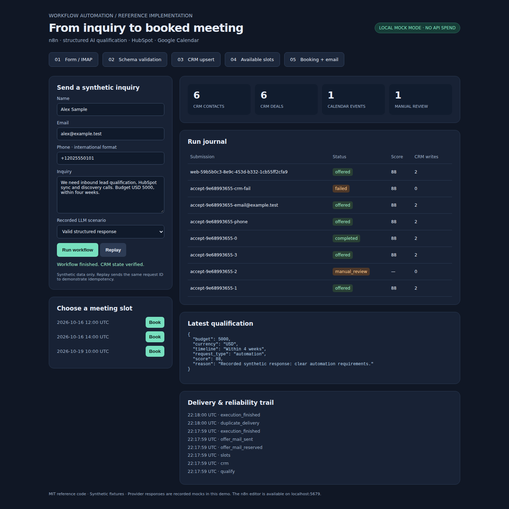
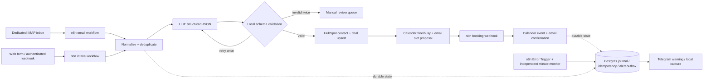

# AI Lead Qualification to CRM and Meeting Booking

[](https://github.com/IgorFedchenko/n8n-ai-lead-to-meeting/actions/workflows/ci.yml)

A working **reference implementation** for businesses that receive inquiries through web forms
and email, then manually qualify leads, update their CRM and arrange discovery calls.
Five n8n workflows turn an inquiry into a qualified HubSpot contact and deal, propose available
meeting slots, and record a Google Calendar event with an email confirmation.

The local demo costs **$0 in API usage**: recorded LLM responses, HTTP doubles for HubSpot and
Google Calendar, a synthetic mail outbox, and a real local IMAP inbox. All names and records are
synthetic. No employer/client code or data is included.



[Recorded booking](docs/images/booked.png) · [Verification evidence and CI recording](docs/VERIFICATION.md)



## Run it

Requires Docker with Compose and Python 3.12+. No API keys or SaaS registration required.

```sh
git clone git@github.com:IgorFedchenko/n8n-ai-lead-to-meeting.git
cd n8n-ai-lead-to-meeting
./scripts/demo.sh
```

On the Studio host, use its shared queue:

```sh
~/.local/bin/studio-heavy-run -- ./scripts/demo.sh
```

Open **http://localhost:8088**. Send an inquiry, click **Replay** to check deduplication, and
book one of the displayed slots. Inspect CRM counts, structured qualification, run journal
and captured email/warning delivery. Choose the invalid-response scenario to see manual review.
The UI calls actual n8n production webhooks rather than bypassing the workflows.

The n8n editor is **http://localhost:5679**. Create a local owner account on first visit; this is
separate from any n8n Cloud account. Workflows and local credentials are imported and published
by the bootstrap container. Workflow `04` is an error handler and is invoked by the other workflows.

`demo.sh` creates an ignored `.env` with random local service/webhook/database secrets (mode 0600).
Only loopback ports are published. Postgres, IMAP and provider doubles stay on the Docker network.
The first launch downloads images and installs pinned Python packages. Startup may take several minutes.

```sh
# Actual n8n + Postgres + IMAP acceptance, with concurrent replay and negative controls:
python3 scripts/verify_demo.py

# Studio equivalent:
~/.local/bin/studio-heavy-run -- python3 scripts/verify_demo.py

# Stop containers; keep the local database:
docker compose down
# To intentionally erase synthetic records and the local n8n owner account:
docker compose down -v
```

## Repository

```text
workflows/     Five importable n8n JSON exports (no secrets)
app/           Transactional state, adapters, synthetic HTTP doubles, demo UI
fixtures/      Synthetic requests, including repair/manual-review/retry scenarios
scripts/       Bootstrap, workflow generator and actual-stack acceptance
tests/         Provider-contract, state, validation, failure and security tests
docs/          Integration setup, reliability boundaries and portfolio copy
compose.yaml   n8n + Postgres + adapter service + doubles + local IMAP/SMTP
```

## Reliability and security

- **Submission identity:** callers supply a stable `request_id`; SHA-256 indexes the run. Reusing
  it with a changed payload returns 409. Source transport may change without changing identity.
- **CRM identity:** normalize email and E.164 phone, resolve both before writing. Conflicting
  matches fail for operator review. Deals use a unique `portfolio_request_id` HubSpot property.
  A Postgres advisory transaction lock serializes identity resolution across workers.
- **Retries:** 429, 5xx and transport errors get three attempts with exponential delays (1/2 s,
  bounded Retry-After); n8n retries a failed HTTP node three times with a one-second pause.
  These budgets are bounded but nested; read [operational limits](docs/INTEGRATIONS.md).
- **Structured AI:** Anthropic Claude is the default live adapter; provider/model are configuration.
  An OpenAI-compatible structured-output adapter is also available. Local validation remains
  mandatory. Invalid responses get one further attempt, then manual review with no CRM writes.
- **Booking:** only offered, future slots with the matching secret token are accepted. Free/busy
  is checked again. A deterministic Google event ID prevents duplicate meetings on replay.
- **Email:** a durable sending reservation prevents automatic resends after uncertain SMTP
  acknowledgement. Such deliveries require operator reconciliation; SMTP cannot promise exactly once.
- **Warnings:** separate error workflow, zero-write checks, stalled-run monitoring and a durable
  alert outbox. Live notifications use Telegram; local mode captures them without contacting anyone.
- **Privacy:** webhook authentication, service authentication, no attachments, bounded input lengths,
  plain-text emails, prompt inputs treated as data, no provider bodies in alerts, no n8n execution
  payload persistence. The application journal has a configurable seven-day retention policy.

## Connect real services

The adapters contain real HTTP/SMTP integration code. Follow [integration setup](docs/INTEGRATIONS.md)
for a free HubSpot developer test account/private app, a dedicated IMAP mailbox, Google Calendar
OAuth, SMTP and Telegram. The operator supplies credentials on the host. **Do not enable live mode
or incur LLM API charges without the owner's approval.** No real credentials or live calls were
needed to build or verify the reference implementation.

## Tests and CI

```sh
python3 -m venv .venv
.venv/bin/pip install -r requirements.lock pytest respx ruff
.venv/bin/ruff check app tests scripts
.venv/bin/pytest -q
```

GitHub Actions runs the unit/contract tests, checks generated exports, then starts the actual
Compose stack and verifies webhooks, Postgres state, IMAP delivery, redelivery, booking, manual
review, rate limiting and the separate error workflow. A Chromium run checks the form, replay,
booking and the private recipient link from the captured invitation email. Successful acceptance produces a JSON
receipt as a CI artifact; it contains identifiers and check names, with no inquiry bodies or secrets.

## Boundaries

This is a small-volume, single-tenant reference implementation. Live HubSpot/Google/SMTP/LLM
acceptance requires operator-owned accounts and credentials; the committed automated proof uses
local doubles. The demo UI is synthetic-only and is disabled in live mode. Do not expose the
local Compose setup to the Internet; add TLS, a reverse proxy, rate limiting and operator RBAC
before hosting it. Booking offers last seven days; expired offers require operator follow-up.

The coarse transaction lock favors correctness over throughput. Calendar free/busy and insert
are separate API calls: another system can still create an overlapping event between them.
Idempotency covers the local retention window; a replay after deletion can create a new inquiry.
Provider-owned CRM and Calendar records are not deleted by local retention. Backups and external
provider retention remain operator responsibilities. Currency conversion, rescheduling, spam
screening, calendar invitations/video links and an operator editing UI are outside this demo.

See [Make/Zapier comparison](docs/ALTERNATIVES.md) for portability and free-tier constraints.

MIT license for original source. n8n and other dependencies retain their respective licenses;
the MIT license does not relicense the bundled runtime dependencies.
