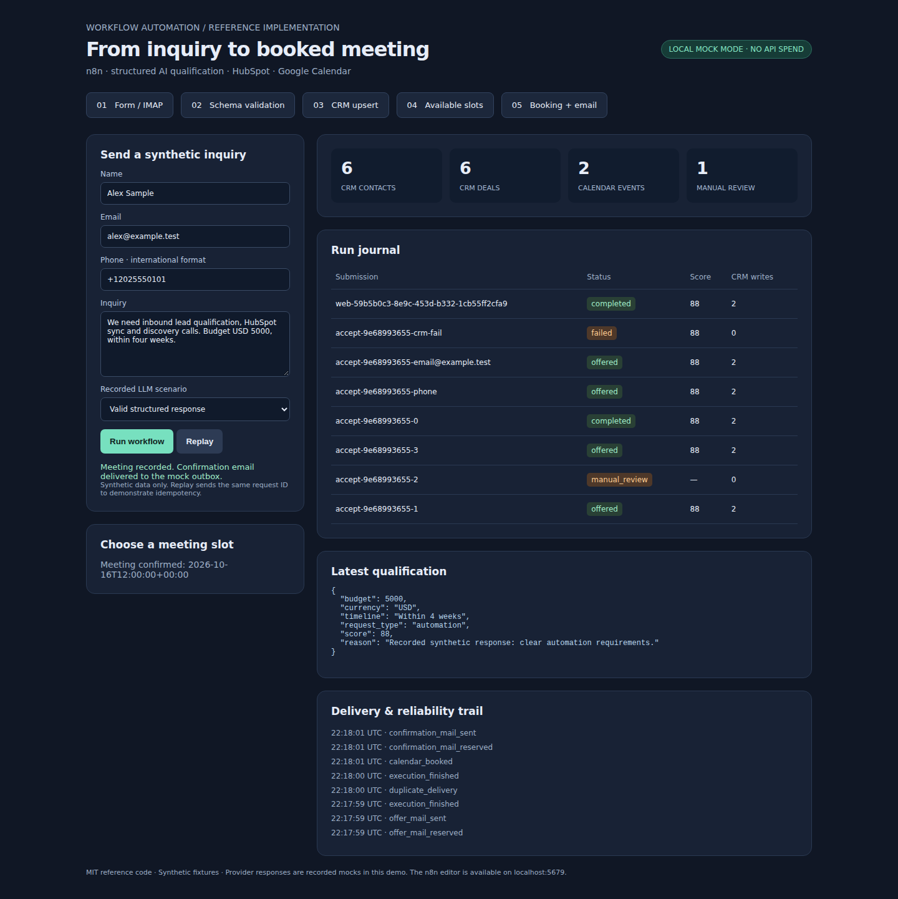

# Verification evidence

Acceptance is only complete with green actual-stack and browser checks on the committed revision.
Real SaaS accounts and paid LLM APIs are excluded from this verification.

## Diagnostic history

- Initial CI: unit/contract checks passed; actual n8n flow stopped at CRM with HTTP 503.
  The error workflow was also not published, which n8n 2.43.6 requires before invoking it.
- Second CI: metadata-only diagnostic probe confirmed fingerprint `done=[qualify], failed_step=crm,
  error=Retryable`, with no mock-server exception. The separately published Error Trigger delivered
  the expected warning. Cause: an empty live HubSpot token from `.env.example` produced the illegal
  HTTP header `Authorization: Bearer ` before any mock CRM request was sent.
- Changed variable: mock authentication now always uses a synthetic token; live authentication rejects
  blank configuration. The service test fixture reproduces blank host credentials, and a direct
  regression test checks both modes. No unchanged failing scenario was blindly rerun.

## Passing evidence

- [Full CI run 38815743482](https://github.com/IgorFedchenko/n8n-ai-lead-to-meeting/actions/runs/38815743482),
  functional revision `7b6627b60d514b23b0d1910af144beee2d1cff7e`: both jobs passed.
- **16 service/contract tests**: validation and repair, empty live credentials in mock mode,
  Anthropic/OpenAI-compatible HTTP contracts, Google OAuth/free-busy/event contracts, payload
  collision, contact identity, slot conflicts, partial CRM failure, uncertain SMTP, retention,
  stalled runs and error alerts. Ruff and export reproducibility checks passed.
- **Actual stack acceptance**: authenticated n8n webhooks, Postgres journal, concurrent redelivery,
  phone/email upsert, JSON repair, invalid output/manual review, 429 retry, real SMTP→IMAP intake,
  Calendar replay, one confirmation email, zero-write warning and separate n8n Error Trigger.
- **Browser acceptance**: inquiry form, replay with unchanged CRM counts, booking and confirmation;
  no JavaScript errors. Screenshots below came from that running stack, with synthetic data only.
- The final CI also follows the invitation email's private recipient booking link.

The CI `acceptance` artifact includes the machine-readable check receipt and browser recording.
Heavy work ran on the GitHub Linux runner. The Studio heavy queue had 49 pending jobs; this
task's still-waiting local ticket was withdrawn before any Docker build started. No other jobs
were interrupted. The same Compose launch command remains available for local owner review.

Live HubSpot, real Calendar accounts, real mail delivery and a paid LLM were not exercised.
Make/Zapier portability is documented; no second hosted scenario is claimed.
